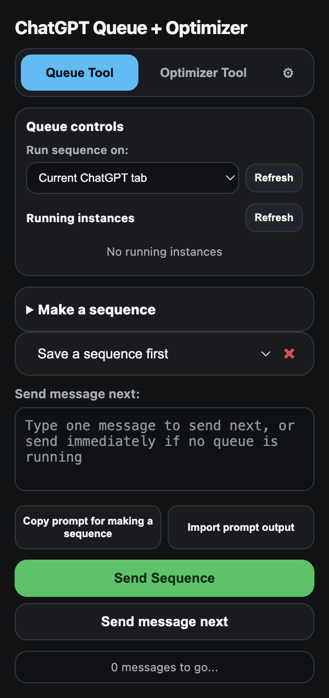

# ChatGPT Queue + Optimizer

Browser extension for running ChatGPT prompt queues and reducing long-chat UI overhead.



The extension combines queue controls, saved prompt sequences, automation logs, and an optional message-window optimizer in one popup.

## Supported browsers

- Google Chrome desktop: primary Manifest V3 target.
- Firefox desktop 140+: supported through the generated Firefox build and installer flow.

The bundled installers explicitly target Google Chrome and Firefox. Other Chromium browsers are not installer-supported.

The extension runs on:

- `https://chatgpt.com/*`
- `https://chat.openai.com/*`
- `https://gemini.google.com/*` (queue support; optimizer unsupported)
- `https://claude.ai/*` (queue support; optimizer unsupported)

## Install

### One-click installers

Windows:

```bat
Installers\Install ChatGPT Queue Optimizer.bat
```

macOS:

```bash
open "Installers/Install ChatGPT Queue Optimizer.app"
```

The installers build browser-specific packages, attempt installation for Chrome and Firefox, and write diagnostics to `build/installer.log`. If something cannot be completed automatically, they also write `build/installer-help-links.txt` with the relevant setup links.

Firefox release builds normally reject unsigned permanent add-ons. The installer tries the persistent path first and falls back to a temporary `web-ext` loader when needed.

See [Installers/README.md](Installers/README.md) for installer details and generated artifacts.

### Manual Chrome install

1. Clone or download this repository, then run `cargo run --release --manifest-path Installers/native/Cargo.toml -- build` to generate the local Rust WASM module.
2. Open `chrome://extensions`.
3. Enable **Developer mode**.
4. Click **Load unpacked**.
5. Select the repository root, which contains `manifest.json`.
6. Open or reload a ChatGPT tab after installing the extension.

### Manual Firefox temporary install

The repository root is the Chrome Manifest V3 source. Build the Firefox-compatible source first:

```bash
cargo run --release --manifest-path Installers/native/Cargo.toml -- package
```

Then:

1. Open `about:debugging#/runtime/this-firefox`.
2. Click **Load Temporary Add-on**.
3. Select `build/firefox-src/manifest.json`.
4. Open or reload a ChatGPT tab.

A temporary Firefox add-on is removed when Firefox restarts. Use the installer flow for its `web-ext` fallback, or a signed AMO package, when you need a longer-lived Firefox installation.

## Quick start

1. Open ChatGPT, Gemini, or Claude in a supported tab.
2. Open the extension popup and stay on **Queue Tool**.
3. Under **Run sequence on**, choose the supported tab you want to control. Use **Refresh** if a newly opened tab is missing.
4. Expand **Make a sequence**, enter a message, press `+`, and repeat for each step.
5. Save the sequence if you want to reuse it, then choose it from **Saved sequence**.
6. Click **Send Sequence** to start the queue.
7. Use **Running instances** to inspect active runs, stop one instance, or stop all instances.

### Send one message next

The **Send message next** field lets you insert a single prompt into the active queue. If no queue is running, the message is sent immediately.

### Sequence helper buttons

- **Copy prompt for making a sequence** copies the helper prompt used to generate a sequence externally.
- **Import prompt output** imports compatible generated sequence output back into the extension.

## Queue settings

Open the gear tab in the popup for queue settings and logs.

- **Deep research aware**: uses a longer finite wait and stale-progress timeout for ChatGPT Deep Research. It is enabled by default and does not wait forever unless **Unlimited retry and wait** is also enabled.
- **Unlimited retry and wait**: the only setting that removes the finite retry/wait bound. Automatic retries still wait between attempts and remain interruptible. It is disabled by default.
- **Automation log**: refresh, copy, or clear the stored automation log for troubleshooting.

If you enable unlimited retry/wait, a queue can remain active for much longer during a stuck or repeatedly failing ChatGPT state.

## Optimizer

The **Optimizer Tool** limits how much conversation UI stays loaded at once in long chats.

The window policy is now implemented in dependency-free Rust (`rust/optimizer_core.rs`), compiled into local WebAssembly and lazily loaded on supported ChatGPT routes. The popup statistics identify Rust/WASM or the compatible JavaScript fallback. Only integer counts cross the boundary; the module does not retain conversation text or DOM objects. Actual browser DOM and React allocations remain browser-owned, so this initial migration does not establish a reduction in page RAM. The queue's decision core now uses Rust, including submission acknowledgement, delivery-timeout recovery routing, scheduled-message transitions and durable restoration/write selection. Asynchronous browser operations, provider observations, JSON projection and storage API calls remain JavaScript.

The production browser execution backend is also Rust (`rust/browser_engine.rs`). It controls bounded resource traversal and aggregation, normalized message discovery, candidate validation, ancestor deduplication, DOM-order indexing, reversible media eviction/restoration, message-window transitions, adaptive expansion/shrink settlement, bounded snapshot text traversal, cache expiry/connectivity validation, and mutation classification with provider ancestor invalidation. `rust-browser-bridge.js` implements browser DOM imports using short-lived integer handles and weakly held media attributes. The original JS execution paths remain available only as compatibility fallbacks. The popup reports the policy and browser execution backends separately. Native discovery checks bounded text prefixes without copying full message strings. Browser-owned DOM and React heap allocations still require browser-native reclamation; this migration is not itself proof of RAM savings.

The local reader loads a third Rust module, `rust/history_engine.rs`, only in its own extension page. It owns versioned binary snapshot row framing, UTF-8 validation, row and snapshot budgets, paging, metadata validation, and ordered IndexedDB transaction commands (read, replace, append, finalize, page and delete). The browser binding owns asynchronous IndexedDB requests and JS strings, and wipes the bounded WASM serialization scratch space after each operation. Legacy object-format and CPO1 uncompressed snapshots remain readable; CPO2 rows use bounded per-row LZ compression when smaller. The 8 MiB budget still counts uncompressed UTF-8 payload plus row overhead, limiting decompression and retaining the previous capture safety limits. The JS fallback also decodes CPO2. JavaScript remains for browser API bindings, event delivery, timer scheduling and compatibility fallbacks.

The fourth module, `rust/queue_engine.rs`, supplies streaming FNV-1a conversation fingerprints using the original ECMAScript whitespace and UTF-16 semantics, plus queue dispatch, submission confirmation, retry decisions, backoff, and progress accounting. It uses bounded scratch space and preserves existing persisted fingerprint values. Queue ABI 2 also owns submission-stage decisions, acknowledgement polling and new-turn acceptance, timeout recovery routing, durable restoration eligibility and phase reconciliation, persistence coalescing/forced flush selection, scheduled due-time comparisons, cancellation/retry/claim/restart decisions, and scheduled target identity matching. The JS bridge executes asynchronous browser effects, mutates durable objects, projects the existing JSON schema, serializes writes, and invokes browser alarms. Existing unconfirmed-submission recovery behavior is retained; interrupted scheduled handoffs still require explicit retry to avoid automatic duplicate delivery. Queue ABI 3 extends Rust ownership to provider host and route classification, bounded UTF-16 marker searches, generation and command response classification, wait failure precedence and terminal eligibility, rollover stage selection, fresh identity checks and generation accounting. ChatGPT, Gemini and Claude use the native provider classifiers when available. Browser engine ABI 3 additionally owns selector-priority traversal, candidate filtering, deduplication and first-match termination. Queue-only providers lazily load this browser module when a queue inspection requests it. Browser URL parsing, DOM query primitives, provider-specific predicates and compatibility selector definitions, browser navigation and asynchronous handoff effects remain JavaScript. Queue and browser ABI 4 add Rust UTF-16 JSON escaping and syntax emission for durable checkpoint comparison (the existing storage objects and schema are unchanged), tab discard authorization, reload fallback ordering, recovery polling and close handling. Provider DOM operations now use Rust-controlled composer reads/writes, input-event sequencing, retry clicks, active-response ancestry, assistant/tool inspection and queued-send stage checks. Native queued submission negotiates capability before any mutation, then requires a short-lived one-use authorization from the current queue owner before clicking; changed drafts and conversation identities prevent the click. A compatibility injection remains available only when native capability was not negotiated. JavaScript still enumerates plain snapshot properties, formats ECMAScript numbers, holds DOM handles, and executes browser APIs. Automatic rollover remains supported only for ChatGPT. Queue ABI 5 defines the full 51-field durable job schema in Rust and drives both live-job projection and deserialization of existing browser structured-clone records. Native field rules supply identity/phase defaults, boolean normalization, finite safe-integer validation, retry mode selection, progress accounting and bounded ECMAScript-compatible UTF-16 trimming. Recovery keeps the existing acknowledged-command reconciliation path. Malformed or empty checkpoints are skipped rather than automatically executed; live projection retains the established JavaScript fallback to prevent losing unexpected in-memory values. Browser object reads/writes, run ID generation, numeric string conversion, and actual storage API calls remain host bindings. Existing storage schemas are unchanged; no storage schema migration is required.

Packaging automatically compiles all four modules using `rustc`; install Rust through rustup if needed. The build installs the `wasm32-unknown-unknown` target when missing.

Settings auto-save:

- **Window Size**: number of messages to keep visible, default `50`, allowed range `10-500`.
- **Batch Size**: number of messages to load at once, default `25`, allowed range `5-100`.
- **Auto-load on scroll**: loads additional messages as you scroll.
- **Experimental offscreen rendering**: opt-in CSS containment for older visible turns. Reduces offscreen layout work but does not free ChatGPT's JavaScript data.
- **Performance statistics**: measures optimizer scan/window timings, skipped streaming-only mutation batches, bounded recent-turn DOM/text/media counts, extension cache references, WASM linear memory, and browser JS heap when available. The DOM sample covers up to 32 recent turns, 512 nodes per turn, and is reused for up to eight seconds when the turn count is unchanged. No message text is copied or stored by the profiler.
- **Media resource eviction**: hidden history releases eligible image `src`, `srcset`, and responsive picture sources, with weakly held original attributes restored when turns are shown. Application-owned blob/data sources are left alone. Optional **Release unused audio/video resources** targets paused media at the beginning of playback only, skipping active, seeked, stream-backed, autoplay and protected media. Browser cache retention and actual reclaimed RAM are not guaranteed. Statistics report cumulative eviction and restoration actions plus estimated decoded image surface bytes targeted, not freed memory.
- **Local history reader (experimental)**: open from the Optimizer Tool, explicitly capture a saved, idle conversation into a single extension-local IndexedDB snapshot, and read 16 turns per page. Rust/WASM owns capture traversal, binary row serialization, paging, transaction sequencing and the 8 MiB estimated UTF-8 payload budget; capture stops at 4,096 turns and limits individual turn text. The snapshot is plain text from the currently loaded DOM, not an authoritative export. It may omit content or formatting, and contains private conversation text in local storage until replaced or deleted. No automatic capture or sync. The separate reader can request browser-native unloading of the original tab after queue, schedule, draft, generation, URL, and identity checks. Open original conversation reloads it. This frees the original browser page when discarding succeeds, without removing nodes from React's live tree. Live interactive in-page DOM virtualization is not implemented.
- **Cache cleanup**: message references expire after 800 ms and provider turn references after eight seconds; structural invalidation and disabling clear them earlier. The scroll observer is reused until disabled or rebound.
- **Adaptive resource budget (experimental)**: opt-in Rust/WASM policy that reduces the automatic recent window according to sampled resource complexity, with the configured window as a ceiling and eight recent turns as the minimum (or all turns if fewer exist). Default budget is 8,000 relative units; these are weighted estimates, not bytes. Auto-load on scroll is suspended in this mode so it cannot immediately undo the budget. Manual Load More overrides the target; Return to budget clears that override. Shrinking an already visible window is deferred while a response, selection, or focused message is active. A JS fallback preserves the policy if WASM is unavailable. The optimizer still hides rather than unmounts turns, so lower visible counts do not prove DOM or React heap reclamation.
- **Unload inactive ChatGPT tabs**: opt-in 15/30/60-minute tab discarding using the browser's native API. Never discards tabs with active queue jobs, scheduled messages, drafts, uploads, or generation. Unsupported or unknown tab state is left alone.
- **Toggle**: enables or disables the optimizer.

The default keyboard shortcut for toggling the optimizer is `Ctrl+Shift+Y`.

## Troubleshooting

### A ChatGPT tab does not appear in the target list

- Confirm the tab is on `chatgpt.com` or `chat.openai.com`.
- Reload the ChatGPT tab after installing or updating the extension.
- Click **Refresh** beside **Run sequence on**.

### The extension says the content script is unavailable or a command stops responding

Reload the target ChatGPT tab. Browser extensions do not retroactively inject updated content scripts into an already-open page after every install/update.

If the problem remains, disable and re-enable the extension, then reload ChatGPT again.

### A queue appears stuck

- Open the gear tab and inspect **Automation log**.
- Refresh **Running instances**.
- Stop the affected instance or use **Stop all instances** if recovery is not possible.
- Enable **Deep research aware** for queues that intentionally use Deep Research.
- Check whether **Unlimited retry and wait** is keeping a repeatedly failing job alive instead of allowing it to stop.

### Firefox will not keep the extension installed

Release Firefox normally blocks unsigned permanent extensions. Use the temporary manual flow above, the installer fallback, or a signed AMO package.

### Installer failure

Check:

- `build/installer.log`
- `build/installer-help-links.txt`

The Windows launcher can locate or install Python, Chrome, Firefox, and Node.js through `winget` when available. The macOS launcher uses existing tools and Homebrew when available.

## Store packaging

Build upload-ready archives without installing or launching a browser:

```bash
cargo run --release --manifest-path Installers/native/Cargo.toml -- package
```

Outputs:

- `build/chatgpt-queue-optimizer-chrome-store.zip` - Chrome Web Store, Manifest V3.
- `build/chatgpt-queue-optimizer-firefox-store.zip` - Firefox AMO, Manifest V2 with Gecko metadata.
- `build/chrome-src/` - generated Chrome source directory.
- `build/firefox-src/` - generated Firefox source directory.

The Firefox package declares a minimum Firefox version of 140.0.

### Submit and test a Firefox update

On Windows, run `upload.bat` from a **clean `main` checkout**. It now automates the complete release sequence: `git pull --ff-only origin main`, `npm ci`, `npm run check`, Rust release and engine tests, a patch-version bump in `manifest.json`, Firefox package generation, AMO submission, and a version-only Git commit pushed to `origin/main`. You need Git push authorization and AMO API credentials. The script does not overwrite local edits, force-push, or continue after failed checks. If submission or pushing fails, inspect `git status` and the upload log before retrying; the bumped manifest or local release commit may remain because Mozilla could already have accepted the version.

On Windows, the `upload.bat` console now stays open after success or failure until you press a key. On failure it prints the exit code and contents of `build/logs/upload.log` when available; the original error output remains visible above.

On macOS, build the native publisher once with `cargo run --release --manifest-path Installers/native/Cargo.toml -- install-upload-launcher`, then run `open upload.app`. The generated Mach-O executable is not tracked and the launcher retains package-and-submit behavior without Git synchronization/version bump. Both platforms launch a separate Firefox test profile and submit to the existing AMO listing without waiting for Mozilla review approval. The public listing continues serving its approved version until Mozilla approves the new one.

The launcher asks for an AMO API key and a hidden API secret (not your AMO account password). Create those credentials at [AMO API credentials](https://addons.mozilla.org/developers/addon/api/key/). They are passed to the submission process without being saved to the repository. Alternatively, set `WEB_EXT_API_KEY` and `WEB_EXT_API_SECRET` in the local environment.

The local test runs in a separate temporary Firefox profile, does not change your normal profile or signature settings, and ends when that test Firefox session closes. Workflow output is saved to `build/logs/upload.log`; Firefox test diagnostics are in `build/logs/upload-firefox-test.log`. This launcher submits to Firefox AMO; it builds the Chrome archive but does not upload to the Chrome Web Store.

To launch only the local test without an AMO submission, run:

```bash
cargo run --release --manifest-path Installers/native/Cargo.toml -- publish --local-only
```

### Local signing keys

the Rust `package` command creates store archives and does not require a private signing key. The installer’s local Chrome CRX path may reuse `build/chrome-key.pem`, which is generated or supplied only in the ignored build directory. Keep the reusable source key in a secure location outside the checkout, copy it into that local build path only when needed, and never restore a key file to the repository root.

Repository metadata confirms that a signing key was previously tracked and that a CRX artifact exists, but it cannot establish whether that key was used for a distributed build or update channel. Verify any historical distribution use with the relevant store or release records before changing a signing identity.

## Development

The repository currently has no declared npm dependencies. Tests use Node's built-in test runner.

Run the test suite with:

```bash
npm test
```

Run the deterministic tracked-file secret check before committing packaging changes:

```bash
python scripts/check_tracked_secrets.py
```

Main files:

- `manifest.json` - Chrome Manifest V3 extension manifest.
- `background.js` - service worker and queue orchestration.
- `content.js` - ChatGPT page integration.
- `popup.html` / `popup.js` - queue, settings, and optimizer UI.
- `options.html` - extension options/about page.
- `Installers/` - browser installer and store-packaging tools.

Contributor setup and validation steps are documented in [CONTRIBUTING.md](CONTRIBUTING.md).

### Native application and release utilities

Queue ABI 6 supplies shared optimizer/queue settings validation, popup status precedence and remaining-message aggregation, log redaction classification, truncation bounds, retention and duplicate suppression. History ABI 3 supplies reader control state, page movement and capture-batch/completion decisions. Browser DOM rendering, async API callbacks and compatibility paths remain JavaScript.

The Rust CLI in `Installers/native` owns production WASM compilation, browser package assembly, MV2 manifest conversion, ZIP output, local installer coordination and managed Windows Firefox publishing. Run `cargo run --release --manifest-path Installers/native/Cargo.toml -- package --repo-dir .` for packages; `install locally.bat` invokes the native installer coordinator and `upload.bat` invokes managed publishing. Rust/Cargo is required; the native CLI resolves its Cargo dependencies on the first build. The native publisher requires explicit invocation, validates a clean main checkout, runs preflight checks, bumps the patch version, uses web-ext to submit, and commits/pushes the release version after confirmed submission. It reads AMO credentials from the environment or hidden console prompts. The Windows browser-specific UI Automation scripts and older Python compatibility/release entry points are retained, and actual browser UI interactions and signing use platform tooling. The native utility has not yet been verified on Windows.

### Rust-driven extension interfaces

Browser ABI 5 renders popup prompt rows, saved-sequence menus, scheduled and running jobs, logs, statistics, popup status and history rows through call-local DOM primitives. Native sequence commands validate edits and saved-sequence operations, and native placeholder scanning returns UTF-16 ranges. Browser-owned values, text formatting, prompts, event callbacks and asynchronous storage remain host-side. The popup and local history reader require their Rust engines and display an error when loading fails; the duplicate JavaScript history codec and IndexedDB transaction decision implementation have been removed. Existing saved object-format rows still load. Core queue/content compatibility fallbacks and browser-specific injection adapters remain pending end-to-end verification. The shared `CpoBrowserApi` host transport consolidates storage, tab and runtime effects and selects the Firefox Promise API or Chromium callback API before invoking a request.

### Native sequence grammar and Windows UI installer

Browser ABI 6 implements bounded JSON and plaintext sequence parsing (including fenced JSON, named sequences, prompt arrays and line lists), literal variable replacement, and native readiness checks for asynchronous content events. The popup uses these exports instead of the former JavaScript import parser and replacement loops. Queued sends require the native dispatcher and content submission capability; the alternate injected JavaScript sender is removed. The optimizer requires both Rust modules before binding and stops/restores the conversation on failed native window application. Snapshot capture requires the native engine. Other older policy and emergency restoration branches are retained pending integration testing. Browser DOM, WebExtension API, structured-clone, timers, promises and event delivery remain thin JavaScript host operations because WebAssembly cannot directly invoke these browser objects.

`install locally.bat` now launches Cargo directly. The default local installer uses `Installers/native/src/windows_ui.rs`, a native COM UI Automation backend, rather than invoking PowerShell. It validates package IDs, uses a stable dedicated Chromium development key, opens the browser's own internal extension page, identifies the browser process/window and chrome address bar, verifies a newly owned foreground file dialog, sets the exact package path, and checks the extension identity. This initial backend requires accessible Invoke/Value/Toggle patterns and English control labels; unsupported or ambiguous UI stops without a blind retry. Native Firefox installation is temporary; no browser security preferences or permanent add-on removal are performed. For recovery only, explicitly run `install locally.bat --browser Firefox --legacy-ui` (or select Chromium/Chrome). No automatic legacy UI fallback is attempted after an uncertain action. Windows compile checks were added to CI, but the backend has not been tested on a live Windows desktop.

The Rust CLI also exposes `build` for standalone WASM generation. The former Python build, package, upload and managed publishing command entry points now delegate to Rust. Historical Python test helpers and the separate old persistent browser registration utility remain for compatibility; they are not the normal local install or release workflow. No automatic store submission is performed during installation.

### Native event routing and recovery (ABI 7)

Queue ABI 7 owns content/background message names, message capability classification, API operation numbers, expected argument counts and Promise-versus-callback transport selection. Browser and extension event callbacks, browser object access, DOM handles and async effects remain minimal JavaScript host bindings. They cannot be invoked directly by the dependency-free WASM modules. Unknown operations and engine failures refuse new automation; emergency storage access and explicit queue cancellation remain available. Active queue dispatch, retry/rollover, response settlement, schedule decisions, durable restoration, optimizer arithmetic, resource scans, media eviction, windowing and mutation classification no longer use alternate JavaScript execution policies. Durable checkpoint writes retain an independent emergency path to avoid losing prompts when WASM fails. Provider bootstrap/read-only compatibility code and emergency media restoration are retained; a trapped or missing WASM engine cannot recover itself. Browser ABI 7 owns normal window/journal restoration; a weak-reference media journal preserves removed attributes even if a source moves outside a conversation turn, and a last-resort host rollback can reveal content after a native trap without adding new optimization effects. Neither new application sources nor detached conversation trees are retained or overwritten by the journal. Native builds and live browser compatibility have not been verified in the editing environment; legacy tests that exercise the former no-WASM execution path need to be reconciled with the required-native contract.

### Native platform transport (ABI 8)

Queue ABI 8 owns WebExtension API method paths, argument validation, modern/legacy script and CSS injection selection, and asynchronous completion decisions. Browser host code resolves the selected method against its actual receiver, marshals arguments, delivers callbacks and settles JavaScript Promises. It never retries a potentially mutating API operation after a failure. Runtime listeners register synchronously for MV3 worker startup. The browser ABI 8 implementation additionally owns trimmed UTF-16 DOM traversal, ancestor iteration and intersection auto-expansion decisions; the host copies at most 256 UTF-16 units per transfer and Rust clears its temporary buffer. These changes do not eliminate JavaScript: actual WebExtension API calls, DOM property reads/writes, Promise objects, listener registration and emergency recovery still require a browser-side host. No additional WASM module or dependency was added. JavaScript syntax and mocked transport smoke tests were checked; native compilation and end-to-end browser behavior remain unverified.

### Native live queue state (Queue ABI 9)

The background worker now holds opaque job handles rather than live JavaScript job records. Rust owns the scalar job fields and pending prompt deque; front/back insertion and removal use `VecDeque`. The browser bridge retains stable handle identity for asynchronous ownership checks, and preserves the existing browser storage schema. Native dirty revisions replace full checkpoint comparison serialization. Durable metadata is cached per job until mutation, and prompt arrays are materialized only when a browser storage write requires structured-clone data. Browser storage still writes complete snapshots; this is not a disk-level incremental transaction. The live store uses Rust's standard allocator (the queue module is no longer `no_std`); WASM size and heap benefits require benchmarking. If native checkpoint construction fails, the previous durable snapshot is preserved. Native compilation and live-browser validation are required before release.
Explicit queue cancellation remains available if the native store becomes unavailable: the browser host serializes the cancellation after pending writes and removes only the selected persisted job (or all jobs for Stop all). No native job is reconstructed in that emergency path.

### Native provider and diagnostic policies (Queue ABI 10 / Browser ABI 9)

Rust supplies ordered provider selectors and compatibility signals, composer/send predicates, Enter eligibility and duplicate/in-flight decisions, diagnostic field selection, bounded UTF-16 normalization and recursive log traversal decisions. The browser binding lazily projects the static catalogs and only materializes permitted diagnostic children. Legacy catalogs and redaction policy remain lazy bootstrap/read-only and engine-failure compatibility paths. DOM queries, browser event cancellation, property enumeration and structured-clone output remain host operations. The browser scanner rejects invalid candidates before text traversal and reuses joined selector strings per scan. Native compilation and browser validation remain required.

Diagnostic traversal depth and child cursors are maintained in Rust; the host observes properties and returns structured-clone values, retaining the emergency sanitizer if native execution fails. Bootstrap selector copies are released when the native catalog becomes available.

### Native collection and presentation utilities (Queue ABI 11)

Scheduled sorting, lookup, removal and due selection use a native batch index projection. Browser storage still owns durable scheduled records and locking; delivery revalidates claims before sending. Conversation keys, command whitespace normalization, continuation handoff text, tab deduplication/provider filtering, title cleanup, popup status labels, running/scheduled labels and optimizer statistic lines are assembled in Rust through bounded UTF-16 field transfers. The browser retains URL parsing, local date and locale collation, exact numeric string conversion and DOM rendering. Bootstrap display fallbacks remain. No new dependencies. Native compilation and live browser tests remain required.

Native batch scratch transfers are wiped after use and oversized buffers are released to the Rust allocator (WebAssembly linear memory itself cannot shrink). Very large browser-owned conversation strings retain the host normalization path to avoid increasing WASM memory solely for string conversion. Browser locale ordering and date display remain unchanged.

### Native sequence and temporal policies (Queue ABI 12)

Rust generates unique imported sequence names, validates reserved names, and collects distinct UTF-16 variables across a sequence in first-appearance order. Native key classification consumes the raw browser key and modifier facts, rejects IME composition and classifies interception eligibility. Gregorian date parsing and validation, local-date round-trip matching, input formatting, scheduled retry defaults, alarm timestamps and queue retry/authorization deadlines are native policies. The browser retains wall-clock access, local timezone/DST interpretation, native event delivery and browser alarm effects. Local date parsing retains the legacy rejection of years 0000–0099. Imported reserved names receive a numeric suffix rather than being rejected at save. The native queue module ABI is 12; browser ABI remains 9. Compilation and browser integration remain to be verified.

### Native-only policy cleanup

Removed duplicated JavaScript provider catalogs, route classifiers, fingerprints, composer implementations, primary conversation discovery/deduplication, popup formatting and recursive diagnostic sanitization. Content startup resolves the provider and loads the required native DOM engine before binding automation. Failed native sanitization drops the entire diagnostic detail object. Browser URL/date parsing, DOM/API effects, large-string host normalization, emergency cancellation and media rollback remain host operations. Legacy no-WASM tests require native fixtures; live browser integration and native compilation remain unverified.

The cleanup also removes duplicate response classification and direct retry-click paths. If native policy is unavailable, provider automation fails closed; emergency cancellation and media rollback remain available. Legacy host-only unit tests have not been migrated or run.

### Native job transactions (Queue ABI 13)

Live job patches and the enqueue, claim, pause, resume, retry, completion, reset and authorized rollover mutations run as native transactions, invalidating checkpoint metadata once per operation. Running-job snapshots are generated from Rust-owned records without reading prompt contents into JS. Failure classification and conversation binding decisions use native policy. Scheduled record state transitions produce native-validated patches under the existing browser storage lock; alarm and storage I/O remain host-owned. Browser effects and asynchronous delivery observations remain host-managed. Native compilation and integration testing are still required.

Restore reconciliation now publishes native handles before applying the classified recovery transaction, and failed transaction preconditions leave the native engine usable. Scheduled completion refuses to overwrite a record whose firing claim is no longer present. Native insertion calculates totals before inserting a new prompt, avoiding double counting when a declared total is stale.

Native release verification includes the Rust tracked-file PEM scanner and Rust publishing tests. Run `cargo test --manifest-path Installers/native/Cargo.toml` for the native suite. The scanner is included in `npm run check` and managed publishing preflight.
